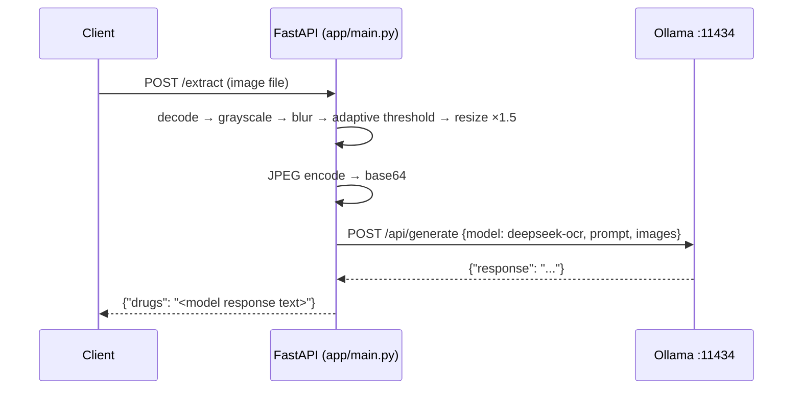

# Prescription OCR API

A small FastAPI service that accepts a photo of a handwritten medical prescription, cleans it up with OpenCV, and asks a locally hosted OCR vision model (`deepseek-ocr` via **Ollama**) to extract the drug names. The repo also contains the notebooks used to compare earlier approaches (TrOCR and a Donut model fine-tuned on prescriptions).

> **Prototype.** This is an experiment, not a medical device. Its output must never be used for clinical or dispensing decisions.

## Problem Statement

Handwritten prescriptions are hard to read and slow to digitise. The goal is to send an image to an API and get back the medications written on it, keeping everything local (no cloud OCR) because prescriptions are sensitive.

## Features

- `POST /extract`: upload an image (multipart `file`) and receive `{"drugs": ...}`.
- OpenCV preprocessing: grayscale → Gaussian blur → adaptive Gaussian threshold → 1.5× upscale.
- Fully local inference through Ollama's `/api/generate` endpoint with the `deepseek-ocr` model.
- A prompt that asks for drug names only, with no guessing, no dosages, and a Python-list output.
- Interactive Swagger docs at `/docs` (FastAPI built-in).

## Technologies

| Component | Package (pinned in `app/requirements.txt`) |
|---|---|
| API | `fastapi==0.115.0`, `uvicorn==0.30.6`, `python-multipart==0.0.9` |
| Image processing | `opencv-python==4.10.0.84`, `numpy==1.26.4`, `Pillow==10.4.0` (listed; not imported by `main.py`) |
| HTTP client to Ollama | `requests==2.32.3` |
| OCR model | `deepseek-ocr` served by [Ollama](https://ollama.com) |
| Notebooks only | `transformers`, `torch`, `Pillow`, `matplotlib` (not pinned) |

## Architecture



## Project Structure

```
prescription-ocr-api/
├── app/
│   ├── main.py            # FastAPI app: preprocessing, Ollama call, endpoints
│   └── requirements.txt
├── notebooks/             # experiments (outputs cleared)
│   ├── 01_trocr_baseline.ipynb               # microsoft/trocr-base-handwritten
│   ├── 02_donut_prescription_model.ipynb     # Donut fine-tuned on handwritten prescriptions
│   ├── 03_donut_with_visualisation.ipynb     # same model + matplotlib display
│   └── 04_ollama_deepseek_ocr_client.ipynb   # same pipeline as the API, run from a notebook
├── .gitignore
└── README.md
```

## Installation

1. Install Ollama: https://ollama.com/download
2. Pull the model:
   ```bash
   ollama pull deepseek-ocr
   ```
3. Install the API dependencies:
   ```bash
   cd app
   python -m venv venv
   venv\Scripts\activate          # Windows  (source venv/bin/activate on Linux/macOS)
   pip install -r requirements.txt
   ```

## Configuration

No environment variables or API keys are needed. The Ollama URL (`http://localhost:11434/api/generate`) and model name (`deepseek-ocr`) are hard-coded in `app/main.py`. Edit them there if your Ollama runs elsewhere.

## Usage

```bash
cd app
uvicorn main:app            # serves on http://127.0.0.1:8000
```

| Method | Path | Description |
|---|---|---|
| `GET` | `/` | Health message: `{"message": "Medical Prescription Drug Extractor API"}` |
| `POST` | `/extract` | Multipart upload field `file`. Returns `{"drugs": <string>}` or `{"error": <string>}` with HTTP 500 |
| `GET` | `/docs` | Swagger UI |

```bash
curl -X POST http://127.0.0.1:8000/extract \
  -H "accept: application/json" \
  -F "file=@prescription.png;type=image/png"
```

## Dataset

No dataset is included and no model is trained in this repository. The notebooks load pretrained models from the Hugging Face Hub:

- `microsoft/trocr-base-handwritten`
- `mjawadazad2321/donut-base-Medical_Handwritten_Prescriptions_Information_Extraction_updated`

The notebooks expect a test image named `image.png` next to them. Supply your own image. The sample prescription used during development is **not** included because it shows a handwritten name and address.

## Model Details and Results

No quantitative evaluation was performed, so no accuracy metrics are reported. In a manual test through Swagger UI, the model returned a free-text transcription of the whole prescription (patient fields, Rx lines, signature block) rather than only a list of drug names. The prompt's output format is not reliably followed.

## Limitations

- `drugs` is returned as the **raw model text**. It is not parsed into a list and may contain non-drug content.
- No input validation: a non-image upload produces a 500 error from `cv2`.
- No timeout on the Ollama request, and the URL and model are hard-coded.
- Single prompt, single model, and no confidence scores.
- `notebooks/` cells contain `!pip install` lines and expect a local `image.png`.

## Future Improvements

- Parse and validate the model output into a JSON list and match it against a drug dictionary.
- Use configurable model/URL settings via environment variables, plus request timeouts.
- Evaluate on a labelled, properly licensed prescription dataset and report metrics.
- Add tests and a Dockerfile.

## Author

**Mosap Abdel-Ghany**: [github.com/Mosapmohamd](https://github.com/Mosapmohamd)
